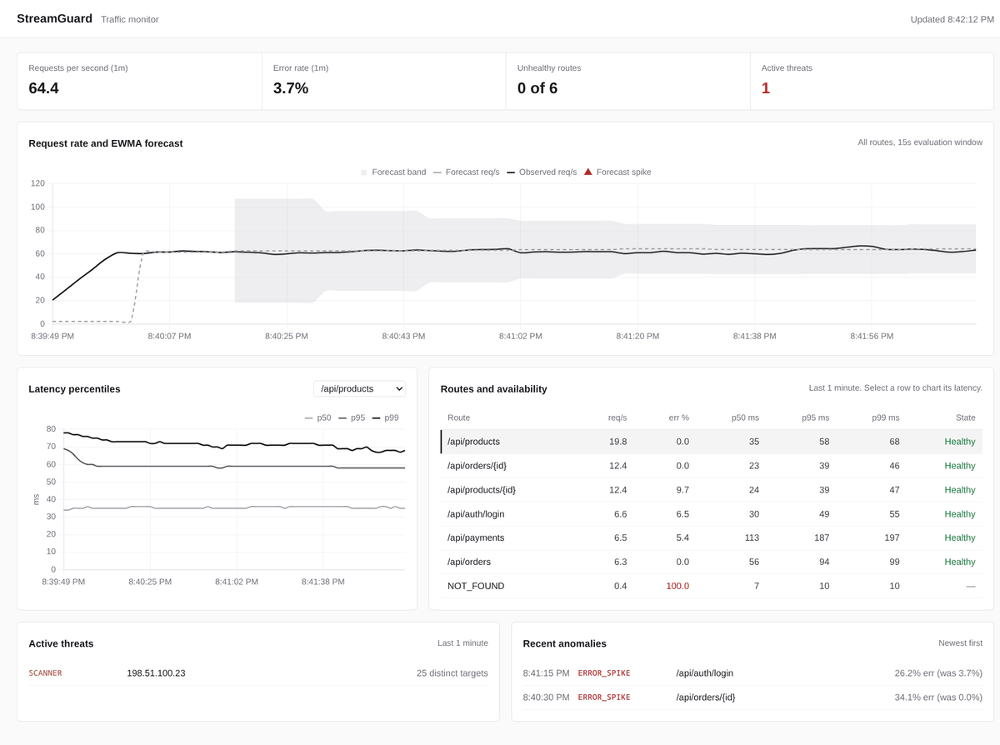
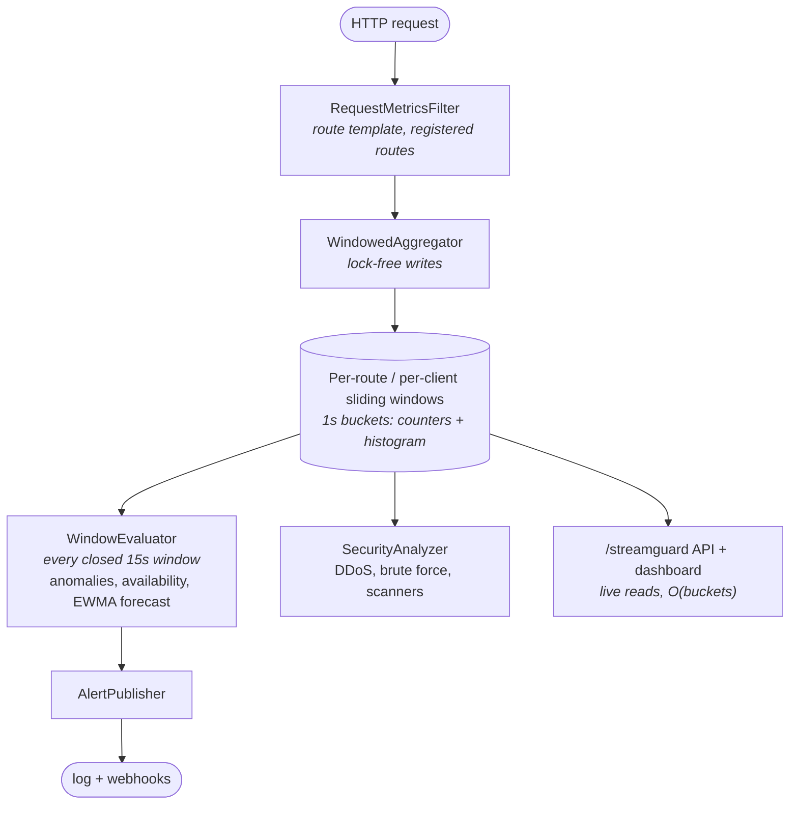

# StreamGuard

[](https://central.sonatype.com/artifact/io.github.eswar-7116/streamguard-spring-boot-starter)

**Real-time traffic monitoring, anomaly detection and threat signals for Spring Boot applications,
added as a single dependency.** No agent, no database, no message queue.

StreamGuard is a Spring Boot starter. Once it's on the classpath, it times every request your
application serves and keeps rolling request rates, error rates and p50/p95/p99 latency per route in
a lock-free sliding-window aggregator. On top of that it detects error, latency and traffic
anomalies, forecasts traffic with an adaptive EWMA, tracks each route's availability, and flags
brute-force, scanner and DDoS patterns. Results are served on a built-in dashboard and JSON API, and
alerts go to any webhook.



## Why StreamGuard?

**Who sets up a monitoring stack when one dependency does the watching and serves a live dashboard?**

Monitoring usually means setting up a collector, a store and dashboards next to your
application, then configuring all of it. With StreamGuard you add a single dependency
and your application reports on itself: a live dashboard, spike and anomaly detection,
brute-force, scanner and DDoS signals, and webhook alerts, all working on defaults.

It's built for services where a monitoring stack would be bigger than the app. It covers a single instance and the last 15 minutes of traffic today. It works with zero configuration, and you can tune routes when you need to.

## Features

- **Per-route metrics**: request rate, error rate and p50/p95/p99 latency over any window up to 15
  minutes. Requests are grouped by route template (`/orders/{id}`, not `/orders/42`), and queries
  take microseconds no matter how much traffic the window holds.
- **Anomaly detection**: error, latency and traffic spikes and traffic drops, compared across
  consecutive closed windows, with small-sample guards against false alarms.
- **Traffic forecasting**: a per-route EWMA with an adaptive smoothing factor predicts the next
  window's rate and raises `FORECAST_SPIKE` when traffic breaks out of its learned band.
- **Availability tracking**: each route moves through HEALTHY → DEGRADED → DOWN → RECOVERING.
- **Security signals**: potential DDoS sources, brute-force attempts on the login routes you
  register, and path scanners.
- **Alerting**: structured log lines plus a JSON POST to every configured webhook.
- **Dashboard and API** at `/streamguard/`, with a configurable path.
- **Low footprint**: one daemon thread, no host-wide `@EnableScheduling`, and memory bounded by
  active routes and clients rather than request volume.

## Requirements

Java 21+ and a Spring Boot 4.1 web application on Spring MVC (servlet stack).

## Installation

StreamGuard is published to Maven Central.

**Gradle**

```kotlin
dependencies {
    implementation("io.github.eswar-7116:streamguard-spring-boot-starter:0.1.0")
}
```

**Maven**

```xml
<dependency>
    <groupId>io.github.eswar-7116</groupId>
    <artifactId>streamguard-spring-boot-starter</artifactId>
    <version>0.1.0</version>
</dependency>
```

Start your application and open **http://localhost:8080/streamguard/**. With no configuration,
every request is monitored.

## Registering routes

Tell StreamGuard which routes to watch and which ones are logins, either in configuration:

```yaml
streamguard:
  routes:
    include: ["/api/**"]          # optional; empty monitors every request
    exclude: ["/api/health", "/actuator/**"]
    auth: ["/api/auth/login", "/oauth/token"]
```

or in code, with a `StreamGuardConfigurer` bean (both sources are combined):

```java
import io.github.eswar7116.streamguard.routes.StreamGuardConfigurer;

@Bean
StreamGuardConfigurer streamGuardRoutes() {
    return routes -> routes
            .exclude("/api/health", "/actuator/**")
            .authRoutes("/api/auth/login");
}
```

- Patterns use Spring MVC syntax: `/api/**`, `/orders/{id}`.
- **Auth routes** enable brute-force detection; nothing is flagged as brute force until at least one
  is registered. They are matched even when a security filter rejects the login before it reaches a
  controller.
- Requests that match no controller are grouped as `NOT_FOUND`, `REDIRECTION` or `UNKNOWN`, so
  random URLs can't flood the route list.
- Prefer `exclude` to narrowing with `include`. Scanner detection works by spotting one client
  requesting many unknown paths, and an `include` pattern hides any request outside it.

## Securing the dashboard

The dashboard and API show traffic details, so restrict them in production. With Spring Security:

```java
http.authorizeHttpRequests(auth -> auth
        .requestMatchers("/streamguard/**").hasRole("OPS")
        .anyRequest().permitAll());
```

To monitor and alert without serving any pages, set `streamguard.web.enabled=false`. Changing
webhooks over the API is off unless `streamguard.alert.allow-runtime-updates=true`.

## Demo

`streamguard-demo` is a sample shop API with a traffic simulator and scripted incidents:

```bash
./gradlew :streamguard-demo:bootRun
```

See [DEMO.md](DEMO.md) for a walkthrough.

## How it works



Each sliding window cuts time into 1-second buckets of `LongAdder` counters and a mergeable latency
histogram with exponential bins. Writes touch only the newest bucket; a query merges the buckets in
range, so its cost depends on the window length, not on event volume. Periodic evaluation runs on
StreamGuard's own daemon thread. [DESIGN.md](DESIGN.md) covers the concurrency design and its
tradeoffs.

## Performance

Measured with `./gradlew :streamguard-spring-boot-starter:benchmark` on a 16-thread Intel Core
i7-13620H laptop, single run.

**Query latency vs. event volume**: a 5-minute snapshot over a bucketed window compared with
rescanning a raw event list:

| Events in window | Bucketed p50 | Raw-list rescan p50 |
|---:|---:|---:|
| 10,000 | 7.9 µs | 1.2 ms |
| 50,000 | 3.7 µs | 5.7 ms |
| 200,000 | 3.4 µs | 27.0 ms |
| 1,000,000 | 0.3 µs | 146.3 ms |
| 2,000,000 | 0.3 µs | 319.5 ms |

Rescan cost grows linearly with traffic; bucketed query cost does not grow with traffic. (The
higher first row is JIT warm-up.)

**Under write load**: 15 writer threads recording into one window for 30 seconds while a
15-minute snapshot runs every 100 ms:

- **30.8M events/sec** sustained through the aggregator (the in-process record path, not HTTP
  requests served).
- **0% histogram loss**: 924,823,200 latency samples for 924,823,200 requests.
- **Query p50 70 µs** across all 899 buckets, flat as the window absorbed 920M events (median
  68 µs in the first half of the run vs 70 µs in the second).

JMH microbenchmarks for the record and snapshot paths: `./gradlew :streamguard-spring-boot-starter:jmh`.

## API

All paths are under `/streamguard/api` (`streamguard.web.base-path` + `/api`). Endpoints that take
`route` return just that route, as a one-element list, or an empty list.

| Endpoint | Purpose |
|---|---|
| `GET /routes?window=1m[&route=]` | Rate, error rate and percentiles per route |
| `GET /routes/top?window=5m&limit=5` | Busiest routes |
| `GET /anomalies` | Recent anomalies, newest first |
| `GET /availability[?route=]` | Availability state per route |
| `GET /forecast[?route=]` | EWMA forecast and spike band per route |
| `GET /security/suspicious-ips?window=1m` | Clients sending an outsized share of traffic |
| `GET /security/threats` | Brute-force and scanner findings |
| `GET /alerts/webhooks` | Configured webhook URLs |
| `PUT /alerts/webhooks` | Replace the webhook list (needs `allow-runtime-updates`) |
| `GET /info` | Window settings |

Windows accept values like `30s`, `1m`, `5m` and `15m`, up to 15 minutes; security windows go up
to 1 minute.

## Detection rules

| Signal | Fires when |
|---|---|
| `ERROR_SPIKE` | Error rate is more than 3× the previous window's (floored at `error-rate-floor-pct`, 5%) and the rise is statistically significant (two-proportion z-test, z ≥ `error-spike-min-z`, 3.09). Not raised while the route has an open `ERROR_RATE_HIGH`. |
| `ERROR_RATE_HIGH` / `ERROR_RATE_RESOLVED` | A sustained-failure alert. Opens when the error rate is at least `error-rate-threshold-pct` (50%) over both the last `error-rate-long-window-seconds` (3 min, with ≥ `min-requests`) and the current window. Resolves after `error-rate-resolve-windows` (2) consecutive windows below `error-rate-recovery-pct` (25%). While open it repeats every `error-rate-repeat-interval-seconds` (4 h) instead of every window. Catches a route that keeps failing, which `ERROR_SPIKE` stops seeing once the failure is the baseline. |
| `LATENCY_SPIKE` | p99 is more than 2× the previous window's (floored at 100 ms), with ≥100 samples in each |
| `TRAFFIC_SPIKE` / `TRAFFIC_DROP` | Request count above 5× or below 20% of the previous window's |
| `FORECAST_SPIKE` | Rate exceeds the EWMA forecast by more than `spike-sigma` deviations, after 3 windows of history. The band is never narrower than the random variation expected at that rate. |
| Availability | DEGRADED after 1 window with >95% errors, DOWN after 3, RECOVERING when errors drop below 50%, HEALTHY after 2 windows below 10%. Windows with no requests change nothing. |
| `POTENTIAL_DDOS` | One client sends more than 30% of traffic (minimum 100 requests) |
| `BRUTE_FORCE` | More than 10 401/403 responses on a registered auth route from one client in a minute |
| `SCANNER` | One client requests more than 20 distinct targets in a minute: routes, or raw paths for requests that matched none |

Windows need at least `min-requests` (20) requests before ratios are compared, and a window is only compared with
one the route was fully observed for, so a restart doesn't look like a traffic spike. `NOT_FOUND`,
`REDIRECTION` and `UNKNOWN` appear in the metrics but are not evaluated for anomalies or
availability.

The error alerts follow established practice rather than inventing thresholds. `min-requests` 20
and a 50% threshold are Hystrix's circuit-breaker defaults (Envoy's outlier detection and
Resilience4j pair a failure percentage with a minimum volume the same way). Opening on a long and a
short window is the Google SRE Workbook's multiwindow alert, with the short window 1/12 of the long
one; the long window also gives low-traffic routes enough samples. A lower recovery threshold is
Datadog's recovery threshold, the resolve window count is Grafana's "keep firing for", and the
repeat interval is Alertmanager's `repeat_interval` (4 h by default). Sudden jumps that may be over
before the long window confirms them are still reported by `ERROR_SPIKE`.

`ERROR_SPIKE` needs both a 3× rise and a significant one. Near `min-requests` the ratio alone is
mostly noise: on a route with 20 requests per window and a steady 5% error rate, it fires about 67
times a day with nothing wrong (about 300 at 10%). The z-test brings both down to under 1 a day. A
significance test alone would be worse on busy routes, where it flags rises too small to act on
(1% to 1.3% over 100,000 requests), so the ratio stays as the "is this big enough" check. The cost
is that a moderate jump on a quiet route needs more than one window of evidence: 2% to 20% over 20
requests is no longer caught on its first window. Large jumps still are (2% to 80%: 99.9%), and
`ERROR_RATE_HIGH` catches failures that persist.

## Configuration

| Property | Default | Purpose |
|---|---|---|
| `streamguard.enabled` | `true` | Master switch |
| `streamguard.web.enabled` | `true` | Serve the dashboard and API |
| `streamguard.web.base-path` | `/streamguard` | Dashboard path; the API is under `<base-path>/api` |
| `streamguard.routes.include` | (all) | Path patterns to monitor |
| `streamguard.routes.exclude` | (none) | Path patterns never monitored |
| `streamguard.routes.auth` | (none) | Login and token routes checked for brute force |
| `streamguard.alert.webhook-urls` | (none) | URLs every alert is POSTed to |
| `streamguard.alert.allow-runtime-updates` | `false` | Allow `PUT /alerts/webhooks` |
| `streamguard.detection.evaluation-window-seconds` | `15` | Length of the windows compared |
| `streamguard.detection.min-requests` | `20` | Minimum window volume before anomaly and error-rate rules evaluate it |
| `streamguard.detection.error-rate-floor-pct` | `5.0` | Lowest baseline `ERROR_SPIKE` compares against |
| `streamguard.detection.error-spike-min-z` | `3.09` | Significance an `ERROR_SPIKE` rise must reach (0.1% false-positive chance per window); `0` disables the test |
| `streamguard.detection.error-rate-threshold-pct` | `50.0` | Error rate that opens `ERROR_RATE_HIGH`; above 100 disables it |
| `streamguard.detection.error-rate-long-window-seconds` | `180` | Window the threshold must also hold over; at most `max-window-seconds` |
| `streamguard.detection.error-rate-recovery-pct` | `25.0` | Error rate that counts toward resolving it |
| `streamguard.detection.error-rate-resolve-windows` | `2` | Consecutive windows below recovery that resolve it |
| `streamguard.detection.error-rate-repeat-interval-seconds` | `14400` | Reminder interval for an open alert; `0` never repeats |
| `streamguard.forecast.base-alpha` | `0.3` | Resting EWMA smoothing factor |
| `streamguard.forecast.spike-sigma` | `3.0` | Deviations above forecast that count as a spike |
| `streamguard.forecast.min-requests` | `20` | Minimum window volume for forecast alerts |
| `streamguard.filter.trust-forwarded-for` | `false` | Read the client IP from `X-Forwarded-For`; only behind a proxy you control |
| `streamguard.windows.bucket-size-seconds` | `1` | Sliding-window resolution |
| `streamguard.windows.max-window-seconds` | `900` | Longest queryable window |

Your IDE autocompletes these properties with descriptions.

## Roadmap

StreamGuard currently monitors the JVM it runs in. Each instance of a horizontally scaled service
sees only its own traffic, and state resets on restart.

1. **Fleet view**: each instance pushes closed 1-second buckets (counters plus histogram) to a
   collector, which merges them by bucket id. Histograms merge by addition, so fleet-wide
   percentiles stay exact to the bin. Detection, forecasting and alerting then run once, on the
   merged series.
2. **Distributed security signals**: instances ship each bucket's heaviest clients and a
   HyperLogLog of distinct paths per client, so an attacker spread across instances is still caught.
3. **Retention**: optional export of closed buckets for history beyond 15 minutes.

[DESIGN.md](DESIGN.md#what-changes-for-multi-node) covers the multi-node design.

## Development

```
streamguard-spring-boot-starter/   the library: auto-configuration, aggregator, detectors, dashboard
streamguard-demo/                  sample application with a traffic simulator
```

```bash
./gradlew test                                           # all tests
./gradlew :streamguard-spring-boot-starter:benchmark     # throughput and query-latency benchmarks
./gradlew :streamguard-spring-boot-starter:jmh           # JMH microbenchmarks
```

## License

StreamGuard is released under the [MIT License](LICENSE).
